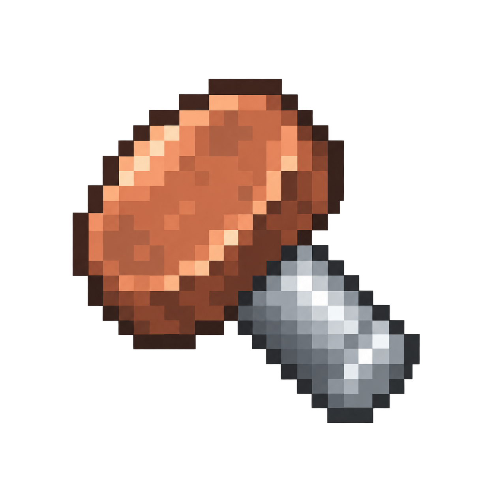

  

<h1 align="center">Rivet</h1>

Сборки, сообщество и задачи — внутри Minecraft.

  <a href="https://github.com/abrosdaniel/rivet/releases/latest">Скачать</a> ·
  <a href="https://abrosdaniel.github.io/rivet/">Документация</a> ·
  <a href="docs/player-guide.md">Руководство игрока</a> ·
  <a href="docs/server/index.md">Настройка сервера</a> ·
  <a href="https://github.com/abrosdaniel/rivet/issues">Сообщить о проблеме</a>

Rivet — мод для Minecraft с NeoForge. Он устанавливает клиентские сборки серверов
и объединяет профили игроков, задачи, события и общение в одном игровом меню.
Один JAR для клиента и сервера; функции управляются настройками сервера.

## Возможности

- Установка и обновление сборок с выбором необязательных компонентов и проверкой файлов.
- Профили игроков, объединения, объявления, события, голосования и предложения.
- Личные и общие задачи с этапами, сроками, комментариями и ресурсами.
- Настраиваемые HUD, уведомления, темы интерфейса и библиотека скинов.
- Карта мира и миникарта, пещерные слои, личные метки и территории.
- Обмен метками через чат и публикация объектов карты с одобрением администратора.
- Каналы чата с историей, оформление TAB и имён игроков, навигация по координатам.
- Серверные инструменты модерации, авторизации и диагностики.
- Java API для модов, REST и WebSocket для внешних приложений.
- Серверный рендер поверхности, пещер и изометрической карты.

Интеграции с LuckPerms, Plasmo Voice, Simple Voice Chat, Waystones, Create: Access Denied,
Create: Numismatics, Envelope и spark
подключаются автоматически при наличии совместимого мода.
[Возможности и проверенные версии](docs/server/integrations.md).
Сборку публикует сервер Rivet; игрок получает её при подключении.
Серверные функции требуют установки Rivet на сервере.

## Требования

| Компонент  | Версия                          |
| ---------- | ------------------------------- |
| Minecraft  | 1.21.1                          |
| Java       | 21                              |
| NeoForge   | От 21.1.250 в ветке 21.1        |
| PostgreSQL | Обязательна для серверной части |

Версия NeoForge в сборке служит рекомендацией; перед установкой Rivet проверяет
требования всех выбранных и сохраняемых модов к установленной версии.

## Установка

**Игрокам:** скачайте JAR из [релиза](https://github.com/abrosdaniel/rivet/releases/latest)
и поместите в `mods/` клиента. Rivet проверяет сборку выбранного сервера до входа.
В игре откройте меню клавишей **F8** или командой `/rivet`.
Подробности — в [руководстве игрока](docs/player-guide.md).

**Владельцам серверов:** поместите JAR в `mods/` сервера и настройте PostgreSQL
в `config/rivet-server.toml`. Установка, конфигурация и права описаны
в [серверном справочнике](docs/server/index.md).

## Документация

[Сайт документации](https://abrosdaniel.github.io/rivet/) · [Исходники документации](docs/)

| Кому | Раздел |
| --- | --- |
| Игрокам | [Сборка, вход и игровые возможности](docs/player-guide.md) |
| Владельцам серверов | [Установка, настройки и эксплуатация](docs/server/index.md) |
| Разработчикам интеграций | [Java](docs/api/java.md), [REST](docs/api/rest.md), [WebSocket](docs/api/websocket.md) |
| Участникам проекта | [Сборка и тесты](CONTRIBUTING.md) |

Сетевые слушатели и серверный рендер выключены по умолчанию.
API-ключами управляют только из локальной консоли сервера.
